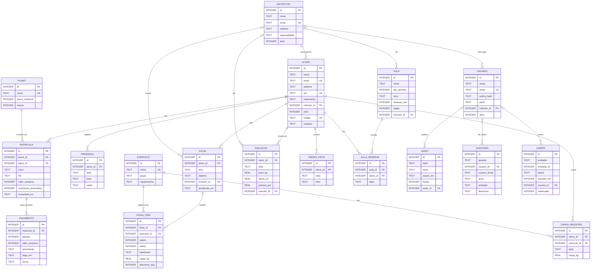

# Modelo do banco de dados (versão 6)

Banco: **SQLite** (arquivo `data/pulso.db`). O SQL completo está em [`../db/schema.sql`](../db/schema.sql) e é
executado automaticamente ao abrir o banco. A versão fica em `PRAGMA user_version = 6`. Bancos das versões 2 a 5 são atualizados no lugar
(`ALTER TABLE ... ADD COLUMN`, sem perder dados); um da versão 1 é guardado como `data/pulso.v1.bak.db` e um novo é criado.

Convenções: datas em texto `AAAA-MM-DD`, horas `HH:MM:SS` (fuso de São Paulo), **dinheiro em centavos** (inteiro,
para não ter erro de arredondamento), CPF e telefone **só com números** (a formatação é feita na tela).

## Diagrama (entidades e relacionamentos)

(O diagrama aparece desenhado no GitHub. Em outros lugares, cole o bloco em <https://mermaid.live>.)
As tabelas `config` e `login_tentativa` são independentes e não aparecem no diagrama.

**Relacionamentos principais**

- Um **aluno** tem várias **matrículas** ao longo do tempo (histórico e renovações); cada matrícula é de um **plano**.
- Cada **matrícula** gera uma ou mais **parcelas** em `pagamento` (um plano trimestral = 3 parcelas mensais).
- Um **aluno** tem várias **presenças**, **fichas** (A a E) e **avaliações**.
- Uma **ficha** tem vários **itens**; cada item aponta para um **exercício** da biblioteca (relação N : N entre ficha e
  exercício resolvida pela tabela `ficha_item`).
- Um **instrutor** pode acompanhar alunos, montar fichas, fazer avaliações e ter um login (`usuario`). Tudo isso é opcional.

## Situação do aluno (calculada, não guardada)

A situação não é uma coluna: é calculada a cada consulta (`lib/consultas.ts`), na ordem de prioridade abaixo.

| Situação | Regra |
|---|---|
| Inativo | `aluno.ativo = 0` |
| Pagamento pendente | Existe parcela com `vencimento < hoje` e `pago_em` vazio |
| Matrícula vencida | Não há matrícula não cancelada cobrindo hoje (`inicio <= hoje <= fim`) |
| Ativo | Nenhuma das anteriores |

Assim nunca há um "status" desatualizado: basta registrar o pagamento e o aluno volta a ativo.

## Dicionário de dados

### aluno

| Coluna | Tipo | Regras |
|---|---|---|
| id | INTEGER | Chave primária, automática |
| nome | TEXT | Obrigatório, 3 a 80 caracteres |
| email | TEXT | Obrigatório, **único** (sem diferenciar maiúsculas) |
| telefone | TEXT | Obrigatório, 10 ou 11 dígitos, só números |
| cpf | TEXT | Obrigatório, **único**, 11 dígitos (dígitos verificadores conferidos no servidor) |
| nascimento | TEXT | Obrigatório, AAAA-MM-DD |
| instrutor_id | INTEGER | Opcional, FK `instrutor(id)`, `ON DELETE SET NULL` |
| ativo | INTEGER | 1 = frequenta, 0 = saiu (cadastro mantido) |
| codigo | TEXT | **Único**, texto do QR code da carteirinha (ex.: `PUL-ZTNGJV`) |
| cadastro | TEXT | Data do cadastro |
| senha_hash | TEXT | Senha do portal do aluno (hash scrypt). Vazia = ainda não fez o primeiro acesso |

### plano

| Coluna | Tipo | Regras |
|---|---|---|
| id | INTEGER | Chave primária |
| nome | TEXT | **Único**, 3 a 30 caracteres |
| preco_centavos | INTEGER | > 0, valor total do período |
| meses | INTEGER | 1 a 24 |

### matricula

| Coluna | Tipo | Regras |
|---|---|---|
| id | INTEGER | Chave primária |
| aluno_id | INTEGER | FK `aluno(id)`, `ON DELETE CASCADE` |
| plano_id | INTEGER | FK `plano(id)`, `ON DELETE RESTRICT` |
| inicio, fim | TEXT | AAAA-MM-DD, `fim >= inicio`. O fim é a véspera do mesmo dia N meses depois |
| valor_centavos | INTEGER | Preço do plano no dia da matrícula (se o preço mudar, o contrato não muda) |
| renovacao_automatica | INTEGER | 1 = ao acabar, o sistema cria a próxima matrícula sozinho |
| cancelada_em | TEXT | Data do cancelamento (vazio = não cancelada) |

### pagamento

| Coluna | Tipo | Regras |
|---|---|---|
| id | INTEGER | Chave primária |
| matricula_id | INTEGER | FK `matricula(id)`, `ON DELETE CASCADE` |
| parcela | INTEGER | ≥ 1; `(matricula_id, parcela)` é **única** |
| valor_centavos | INTEGER | > 0. As parcelas somam o valor da matrícula; os centavos que sobram ficam na primeira |
| vencimento | TEXT | AAAA-MM-DD |
| pago_em | TEXT | Vazio enquanto não pago |
| forma | TEXT | `pix`, `cartao`, `dinheiro` ou `boleto`. **Obrigatória se e somente se** houver `pago_em` |
| informado_em | TEXT | Quando o aluno avisou pelo portal que pagou por Pix (a recepção confere e registra) |

### presenca

| Coluna | Tipo | Regras |
|---|---|---|
| id | INTEGER | Chave primária |
| aluno_id | INTEGER | FK `aluno(id)`, `ON DELETE CASCADE` |
| data | TEXT | AAAA-MM-DD |
| hora | TEXT | Entrada, HH:MM:SS |
| saida | TEXT | Saída (vazio = ainda está na academia, usado na lotação); `saida >= hora` |
| (aluno_id, data) | — | **Única**: uma entrada por aluno por dia |

### instrutor

| Coluna | Tipo | Regras |
|---|---|---|
| id | INTEGER | Chave primária |
| nome | TEXT | 3 a 80 caracteres |
| email | TEXT | **Único** |
| telefone | TEXT | Obrigatório |
| especialidade | TEXT | Até 60 caracteres |
| ativo | INTEGER | 0 ou 1 |

### exercicio

| Coluna | Tipo | Regras |
|---|---|---|
| id | INTEGER | Chave primária |
| nome | TEXT | **Único**, 3 a 60 caracteres |
| grupo | TEXT | peito, costas, ombros, biceps, triceps, pernas, gluteos, abdomen, cardio ou corpo_todo |
| equipamento | TEXT | 2 a 40 caracteres |
| descricao | TEXT | O que o exercício trabalha (até 400 caracteres) |
| execucao | TEXT | Passo a passo, um passo por linha |
| dicas | TEXT | Dicas e erros comuns, um por linha |
| musculos_primarios / musculos_secundarios | TEXT | Ids dos músculos separados por vírgula (lista em `lib/musculos.ts`) |
| video_url | TEXT | Link do YouTube ou de um arquivo .mp4/.webm (validado no servidor; só https). Opcional |
| animacao | TEXT | Pasta das fotos da animação em `public/exercicios/<pasta>/` (0.jpg e 1.jpg) |

### ficha e ficha_item

| Coluna | Tipo | Regras |
|---|---|---|
| ficha.aluno_id | INTEGER | FK `aluno(id)`, `ON DELETE CASCADE` |
| ficha.letra | TEXT | A a E; `(aluno_id, letra)` **única** |
| ficha.objetivo | TEXT | Até 60 caracteres |
| ficha.instrutor_id | INTEGER | FK opcional, `ON DELETE SET NULL` |
| ficha.dias | TEXT | Dias da semana da ficha (0 = segunda ... 6 = domingo), ex.: `0,3`. Vazio = sem dia fixo |
| ficha_item.ficha_id | INTEGER | FK `ficha(id)`, `ON DELETE CASCADE` |
| ficha_item.exercicio_id | INTEGER | FK `exercicio(id)`, `ON DELETE RESTRICT` |
| ficha_item.ordem | INTEGER | Posição do exercício na ficha |
| series / repeticoes | INTEGER / TEXT | 1 a 10 séries; repetições em texto (ex.: `10-12`) |
| carga_kg / descanso_seg | REAL / INTEGER | Opcionais (0 a 500 kg; 0 a 600 s) |

### avaliacao

| Coluna | Tipo | Regras |
|---|---|---|
| aluno_id | INTEGER | FK `aluno(id)`, `ON DELETE CASCADE`; `(aluno_id, data)` **única** |
| peso_kg | REAL | 20 a 300, obrigatório |
| altura_cm | REAL | 100 a 250, obrigatório (o IMC é calculado na tela) |
| gordura_pct | REAL | Opcional, 2 a 70 |
| cintura_cm, quadril_cm, braco_cm, coxa_cm | REAL | Opcionais, com faixas de valores válidos |
| instrutor_id | INTEGER | FK opcional, `ON DELETE SET NULL` |

### treino_feito

| Coluna | Tipo | Regras |
|---|---|---|
| aluno_id | INTEGER | FK `aluno(id)`, `ON DELETE CASCADE` |
| data | TEXT | Dia em que o aluno marcou o treino como concluído no portal |
| letra | TEXT | Letra da ficha (copiada, para o histórico não mudar se a ficha for refeita); `(aluno_id, data, letra)` **única** |

### aula e aula_reserva

| Coluna | Tipo | Regras |
|---|---|---|
| aula.nome | TEXT | 3 a 40 caracteres |
| aula.dia_semana / hora | INTEGER / TEXT | 0 = segunda ... 6 = domingo; `HH:MM`. Uma linha por dia e horário da grade |
| aula.duracao_min / vagas | INTEGER | 15 a 180 minutos; 1 a 200 vagas |
| aula.instrutor_id | INTEGER | FK opcional, `ON DELETE SET NULL` |
| aula.ativo | INTEGER | 0 = some do portal (as reservas antigas ficam) |
| aula_reserva.aula_id / aluno_id | INTEGER | FKs com `ON DELETE CASCADE`; `(aula_id, data, aluno_id)` **única** |
| aula_reserva.data | TEXT | Data da aula reservada |

O limite de vagas e o conflito de horário são conferidos numa transação `BEGIN IMMEDIATE` (`lib/aulas.ts`): duas
pessoas tentando a última vaga ao mesmo tempo não passam do limite.

### carga_registro

| Coluna | Tipo | Regras |
|---|---|---|
| aluno_id / exercicio_id | INTEGER | FKs com `ON DELETE CASCADE`; `(aluno_id, exercicio_id, data)` **única** (anotar de novo no dia substitui) |
| carga_kg | REAL | 0 a 500 |
| repeticoes | INTEGER | Opcional, 1 a 100 |

### aviso

| Coluna | Tipo | Regras |
|---|---|---|
| titulo / texto | TEXT | 3 a 80 / 3 a 600 caracteres |
| expira_em | TEXT | Opcional: depois desse dia o aviso some do portal |
| fixado | INTEGER | 1 = aparece primeiro |
| autor_id | INTEGER | FK `usuario(id)`, `ON DELETE SET NULL` |

### usuario

| Coluna | Tipo | Regras |
|---|---|---|
| nome | TEXT | 3 a 80 caracteres |
| email | TEXT | **Único** |
| senha_hash | TEXT | Hash scrypt com sal; a senha nunca é guardada |
| perfil | TEXT | `admin`, `recepcao` ou `instrutor` (permissões em `lib/permissoes.ts`) |
| instrutor_id | INTEGER | Liga o login a um instrutor (opcional), `ON DELETE SET NULL` |
| ativo | INTEGER | 0 = não consegue mais entrar |

### Tabelas do sistema

| Tabela | Para que serve |
|---|---|
| `config` | Chave/valor: `capacidade_maxima` (lotação), `pix_chave`, `pix_nome`, `pix_cidade` (Pix da academia) |
| `login_tentativa` | E-mail, IP, horário e se deu certo. Usada no bloqueio: 5 erros por e-mail ou 20 por IP em 15 minutos |
| `auditoria` | Quem fez o quê e quando. O e-mail é copiado, então o registro não se perde se o usuário for excluído |
| `lixeira` | Antes de excluir, o registro e tudo que depende dele vão em JSON para cá; "Desfazer" recoloca as linhas com os mesmos ids (até 5 minutos) |

## Regras de integridade (o que o banco garante sozinho)

| Situação | O que acontece | Mecanismo |
|---|---|---|
| Excluir um plano já usado em matrícula | **Bloqueado** | `ON DELETE RESTRICT` |
| Excluir um exercício que está em alguma ficha | **Bloqueado** | `ON DELETE RESTRICT` |
| Excluir um aluno | Matrículas, parcelas, presenças, fichas, avaliações e treinos concluídos saem **junto** | `ON DELETE CASCADE` |
| Excluir um instrutor | Alunos, fichas e avaliações ficam sem instrutor (não são apagados) | `ON DELETE SET NULL` |
| E-mail ou CPF repetido | Bloqueado | `UNIQUE` |
| Duas entradas do mesmo aluno no mesmo dia | Bloqueado | `UNIQUE (aluno_id, data)` |
| Pagamento com data mas sem forma (ou o contrário) | Bloqueado | `CHECK ((pago_em IS NULL) = (forma IS NULL))` |
| Matrícula que termina antes de começar, saída antes da entrada | Bloqueado | `CHECK` |
| Perfil, grupo muscular ou forma de pagamento fora da lista | Bloqueado | `CHECK (... IN (...))` |
| Referência a registro que não existe | Bloqueado | Chave estrangeira (`PRAGMA foreign_keys = ON`) |

A validação no servidor mostra mensagens amigáveis antes de chegar ao banco; as restrições acima são a segunda camada.

## Índices

- `aluno(instrutor_id)`: filtro por instrutor.
- `matricula(aluno_id, inicio)`, `matricula(plano_id)`, `matricula(fim)`: matrícula atual, contagem por plano e vencimentos.
- `pagamento(vencimento)`, `pagamento(pago_em)`: inadimplência e receita por mês.
- `presenca(data)`: painel, lotação e alunos em risco.
- `ficha_item(ficha_id, ordem)`, `ficha_item(exercicio_id)`: montar a ficha e checar uso do exercício.
- `login_tentativa(email, quando)`, `login_tentativa(ip, quando)`: bloqueio de login.
- `auditoria(quando)`: listagem do log.

## Consultas principais

- **Lista de alunos**: uma CTE (`WITH`) junta aluno, matrícula atual (`ROW_NUMBER() OVER (PARTITION BY aluno_id ...)`),
  dívida, última presença e calcula a situação com `CASE`. Filtros, ordenação e `LIMIT/OFFSET` acontecem no banco.
- **Inadimplência**: soma das parcelas com `vencimento < hoje AND pago_em IS NULL`, agrupada por aluno.
- **Vencimentos próximos**: matrículas com `fim` entre hoje e hoje + 7 dias, sem renovação automática e sem próxima matrícula já criada (`NOT EXISTS`).
- **Alunos em risco**: situação ativo ou pendente e a última presença (ou o início da matrícula, se nunca veio) há mais de 14 dias.
- **Receita por mês**: `SUM(valor_centavos)` agrupado por `substr(pago_em, 1, 7)` (recebido) e por `substr(vencimento, 1, 7)` (previsto).
- **Lotação**: presenças de hoje com `saida IS NULL`.
