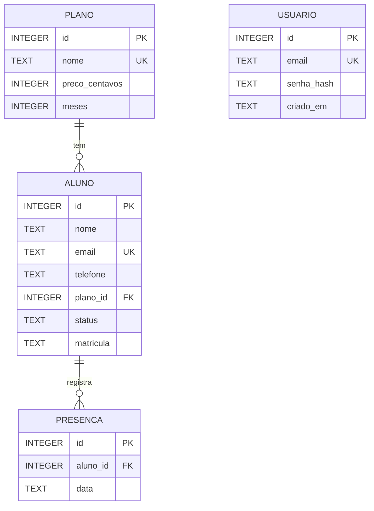

# Modelo do banco de dados

Banco: **SQLite** (arquivo `data/pulso.db`). O SQL completo está em [`../db/schema.sql`](../db/schema.sql) e
é executado automaticamente na primeira execução.

## Diagrama (entidades e relacionamentos)

(O diagrama aparece desenhado no GitHub. Em outros lugares, cole o bloco em <https://mermaid.live>.)

**Relacionamentos**

- Um **plano** pode ter muitos **alunos**; cada aluno tem exatamente um plano (1 : N).
- Um **aluno** pode ter muitas **presenças** (entradas na academia); cada presença é de um aluno (1 : N).
- **usuario** é independente: guarda apenas quem pode entrar no sistema.

## Dicionário de dados

### plano

| Coluna | Tipo | Regras |
|---|---|---|
| id | INTEGER | Chave primária, automática |
| nome | TEXT | Obrigatório, **único** (sem diferenciar maiúsculas), de 3 a 30 caracteres |
| preco_centavos | INTEGER | Obrigatório, maior que 0 (valor em centavos, ex.: R$ 99,90 = 9990) |
| meses | INTEGER | Obrigatório, de 1 a 24 |

### aluno

| Coluna | Tipo | Regras |
|---|---|---|
| id | INTEGER | Chave primária, automática |
| nome | TEXT | Obrigatório, mínimo 3 caracteres |
| email | TEXT | Obrigatório, **único** (sem diferenciar maiúsculas) |
| telefone | TEXT | Obrigatório (validado no servidor: 10 ou 11 dígitos) |
| plano_id | INTEGER | Obrigatório, **chave estrangeira** para `plano(id)`, `ON DELETE RESTRICT` |
| status | TEXT | `ativo`, `pendente` ou `inativo` (padrão `ativo`) |
| matricula | TEXT | Obrigatório, data no formato AAAA-MM-DD |

### presenca

| Coluna | Tipo | Regras |
|---|---|---|
| id | INTEGER | Chave primária, automática |
| aluno_id | INTEGER | Obrigatório, **chave estrangeira** para `aluno(id)`, `ON DELETE CASCADE` |
| data | TEXT | Obrigatório, data no formato AAAA-MM-DD |
| hora | TEXT | Obrigatório, hora no formato HH:MM:SS (fuso de São Paulo) |
| (aluno_id, data) | — | **Única**: um aluno só tem uma entrada por dia |

### usuario

| Coluna | Tipo | Regras |
|---|---|---|
| id | INTEGER | Chave primária, automática |
| email | TEXT | Obrigatório, **único** |
| senha_hash | TEXT | Hash scrypt com sal. A senha nunca é guardada em texto puro |
| criado_em | TEXT | Preenchido automaticamente |

## Regras de integridade (o que o banco garante sozinho)

| Situação | O que acontece | Mecanismo |
|---|---|---|
| Excluir um plano que tem alunos | **Bloqueado** | `ON DELETE RESTRICT` |
| Excluir um aluno | O histórico de entradas dele é **excluído junto** | `ON DELETE CASCADE` |
| Cadastrar dois alunos com o mesmo e-mail | Bloqueado | `UNIQUE (email)` |
| Registrar duas entradas do mesmo aluno no mesmo dia | Bloqueado | `UNIQUE (aluno_id, data)` |
| Aluno apontando para um plano que não existe | Bloqueado | Chave estrangeira (`PRAGMA foreign_keys = ON`) |
| Preço zero ou negativo, status inválido, data mal formada | Bloqueado | `CHECK` |

A validação do sistema (no servidor) mostra mensagens amigáveis antes de chegar ao banco; as restrições acima
são a segunda camada de proteção.

## Índices

- `idx_aluno_plano` em `aluno(plano_id)`: acelera a listagem por plano e a contagem de alunos por plano.
- `idx_aluno_status` em `aluno(status)`: acelera o filtro por status.
- `idx_presenca_data` em `presenca(data)`: acelera o painel (entradas por dia).

## Consultas principais

- **Listagem de alunos** com busca, filtro e ordenação: `aluno` junto com `plano` (JOIN), `LIKE` para a busca.
- **Receita mensal estimada**: soma de `preco_centavos / meses` dos alunos ativos (JOIN com `plano`).
- **Gráficos do painel**: `SELECT data, COUNT(*) FROM presenca WHERE data >= ... GROUP BY data` (por dia) e `substr(hora, 1, 2)` para agrupar por hora.
